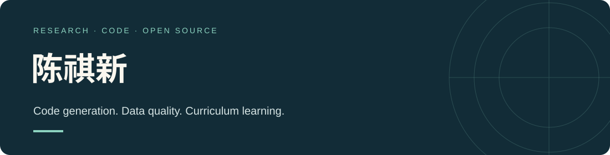

### 你好，我是陈祺新 👋

这里记录我的研究与代码实践，当前展示的工作是 **CAFCL：面向代码生成的复杂度感知筛选与课程学习**。

[个人网站](https://1943432515.github.io/) · [论文 PDF](https://github.com/1943432515/cqx-code-generation/blob/main/paper/CAFCL.pdf) · [CAFCL 源码](https://github.com/1943432515/cqx-code-generation)

---

### 研究与项目

**CAFCL · Complexity-Aware Curriculum Learning for Code Generation**

将数据质量筛选与从易到难的训练顺序结合，探索代码生成模型的微调方法。项目使用 Qwen3-0.6B，并通过 HumanEval 进行评测。

- **数据准备**：指令复杂度评分、数据筛选、课程数据生成。
- **模型训练**：随机顺序基线、筛选后训练、三阶段 CAFCL 训练。
- **实验评测**：代码生成、后处理、HumanEval 功能正确性评测。

### 项目中的技术

`Python` · `PyTorch` · `Transformers` · `LoRA / PEFT` · `verl` · `HumanEval`

欢迎通过 [GitHub](https://github.com/1943432515) 了解我的项目。
